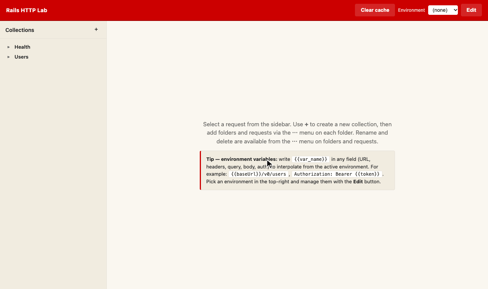

# rails-http-lab

In-app HTTP request lab for Rails. Mounts a UI at `/rails/http-lab` and persists collections as `.bru` files that are interchangeable with the [Bruno](https://www.usebruno.com/) desktop app.

No external app, no separate workspace — your requests live next to the code that serves them, version-controlled in `docs/http-lab/`.



## Why

Postman / Insomnia / Bruno are great, but every one of them lives outside your
Rails app and outside your repo. With `rails-http-lab`:

- Requests are **files in the repo** (`docs/http-lab/*.bru`), reviewable in PRs.
- The UI runs **inside your Rails app** — no CORS, can reach internal services.
- Files use the **Bruno format**, so the same collection opens in Bruno desktop.
  Round-trip is byte-stable (verified against the public Bruno corpus).

## Install

```ruby
# Gemfile
gem "rails-http-lab", group: :development
```

```bash
bundle install
bin/rails g rails_http_lab:install
```

Visit `http://localhost:3000/rails/http-lab`.

## Compatibility

Requires Ruby `>= 3.1` and Rails `>= 7.0`. Every combination below runs in
[CI](.github/workflows/ci.yml):

| Ruby \ Rails | 7.0 | 7.1 | 7.2 | 8.0 | 8.1 |
|--------------|:---:|:---:|:---:|:---:|:---:|
| **4.0**      | ✅  | ✅  | ✅  | ✅  | ✅  |
| **3.4**      | ✅  | ✅  | ✅  | ✅  | ✅  |
| **3.3**      | ✅  | ✅  | ✅  | ✅  | ✅  |
| **3.2**      | ✅  | ✅  | ✅  | ✅  | ✅  |
| **3.1**      | ✅  | ✅  | ✅  | —   | —   |

— Rails 8.x itself requires Ruby `>= 3.2`.

## Configuration

`config/initializers/rails_http_lab.rb`:

```ruby
RailsHttpLab.configure do |c|
  c.mount_path   = "/rails/http-lab"                # default
  c.storage_path = Rails.root.join("docs/http-lab") # default
  c.enabled_envs = %i[development]                  # default
  # c.authenticator = ->(request) { request.session[:admin] }
end
```

## Security

The executor performs HTTP requests **from the Rails server**. That's the point —
it lets you reach internal services without CORS. It is also a confused-deputy
risk if exposed to untrusted users. Defaults:

- Enabled only in `development` (`enabled_envs`).
- Enabling in `production` requires an `authenticator` callable; the engine
  refuses to boot otherwise.
- Bruno `script` and `tests` blocks are **persisted but not executed** to avoid
  arbitrary code execution. Run them in Bruno itself.

## Development

```bash
bundle install
bundle exec rspec
```

To run the suite against a specific Rails series (as CI does), set
`RAILS_VERSION` before installing:

```bash
RAILS_VERSION=7.2 bundle update rails && RAILS_VERSION=7.2 bundle exec rspec
```

## License

MIT
